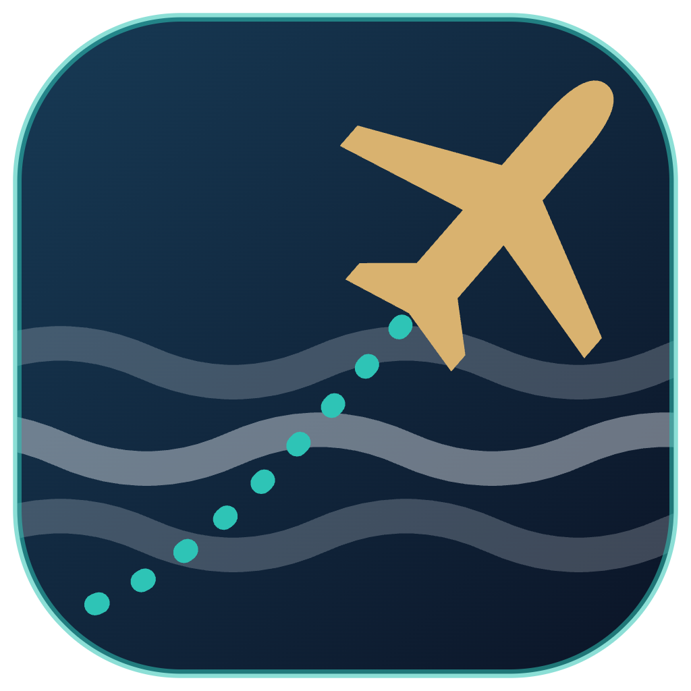
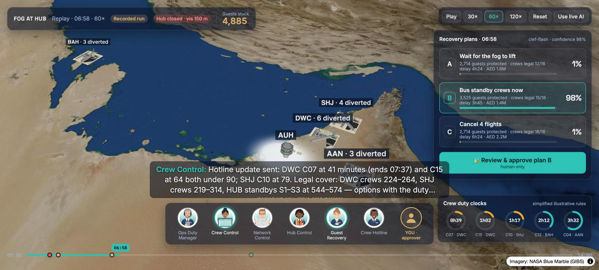
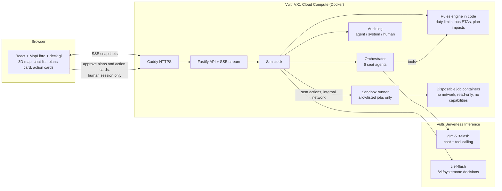

# Fly-Through

[](LICENSE) [](https://youtu.be/T5RO_MAhdt0) [](https://64.177.57.178.sslip.io)

**Your pilots train in a flight simulator. Your operations room doesn't.**

Fly-Through is an airline operations-control war room where **AI agents fill every seat** (Ops Duty Manager, Crew Control, Network Control, Hub Control, Guest Recovery, Crew Hotline) and work a real disruption together, while **one human approves** the recovery plan. It replays a bad day so an ops team can see where time is lost, and rehearses a plan before it goes live.

**Live demo:** https://64.177.57.178.sslip.io (opens on a recorded run; press **Use live AI** for a fresh run with live Vultr inference)

Built for the **Vultr: Agent Rush** hackathon (Track 2: Powering the Future of Work). It is an operations-control workflow that spans the track's focus areas: guest rebooking and care is **customer support**, buses and hotels for crews are **procurement**, and crew legality and standby cover is **workforce management**.

> **Demo video (2 min):** https://youtu.be/T5RO_MAhdt0
>
> The demo is one shared session. If you arrive mid-run, press **Reset**; the sim also rewinds by itself 3 minutes after the last viewer leaves.



## The scenario: fog at the hub

A synthetic day inspired by a documented fog morning at a Gulf hub:

1. **05:52** Fog closes the hub (visibility 150 m). 16 inbound flights divert to Dubai World Central, Sharjah, Al Ain and Bahrain, and the guest counter climbs.
2. The six seats call out, check facts with tools, and hand work to each other ("Crew Hotline → Crew Control: C07 at DWC has 44 minutes left").
3. **06:58** Decision point. The sim pauses and three recovery plans arrive: **A** wait for the fog, **B** bus standby crews now, **C** cancel 4 flights. Their impacts (guests protected, crews kept legal, delay, cost, and the safety facts behind each) are computed in code.
4. **The seats debate.** Each seat argues from the criterion it owns (Guest Recovery: passengers; Network Control: punctuality and schedule; Hub Control: security and ground risk; Crew Control: the safety gate; the duty manager: cost and environment) and takes a position with a tool; in round 2 each answers the strongest argument against it. Votes appear on the plans card.
5. **The AI check: a safety gate, then six weighted criteria** (see below). The plans card shows the gate, any safety warning, a weighted score per plan and the criteria table.
6. **Only the human can approve.** Buses leave the hub with live ETAs and crews are relieved on arrival.
7. **07:25 The seats act, not just advise.** Guest Recovery books meal vouchers at every diversion airport and Crew Control and the Crew Hotline book rest rooms for crews close to their limit: each action runs at once as a job in a sandbox, inside the seat's delegated budget. A hotel block for the biggest airport would take Guest Recovery past its budget, so it becomes an **approval card** for the human instead (see below).
8. **08:30 The forecast changes.** A met update moves the fog lift from 09:30 to 10:45, so three more crews would time out before they can fly home. At **08:32** the room debates and decides again, this time with three reserve crews called in for the afternoon, built on what the first approval already set in motion. Crew Control asks to **position a fresh crew to Bahrain** (no road: a bus to DXB, then a flight); at AED 18,000 it is over its delegated AED 15,000, so it is a card too. Approved, it brings the Bahrain aircraft home before a crew sent after reopening could.
9. **10:45 The hub reopens.** Arrivals restart at 20 an hour; each diverted aircraft flies home in its slot with its own crew if that crew can still land legally, else a bussed relief crew, else a fresh crew sent after reopening. Planes fly home on the map, guests stuck drains to zero, and the seats keep calling out progress with a `get_recovery` tool.
10. **Debrief** once the last aircraft is home (13:45 in the shipped run): time to the first decision, both approvals and whether the AI agreed, guests protected, aircraft home, handoffs, and how many call-outs were backed by tool checks.

## Seats act within delegated budgets, in a sandbox

Three seats own actions with a price list in code (illustrative AED): hotel rooms (250 a guest) and meal vouchers (40 a guest) for **Guest Recovery**, crew rest rooms (600 a crew) for **Crew Control** and the **Crew Hotline**, and a crew positioning trip (18,000) for **Crew Control**. Each has a delegated budget: Guest Recovery AED 300,000, Crew Control 15,000, Crew Hotline 10,000.

- A seat calls `request_action`. Code checks that the seat owns the action, that the airport and quantity are real (guest care only for guests who have waited an hour there, never more than that, counting what is already booked), and prices it.
- **Within budget** it runs at once, as the seat's own decision ("Done · delegated" in the chat).
- **Over budget** it becomes an approval card on the plans panel ("Over budget · needs you"). Only the human's session can approve or decline it (`POST /api/actions/:id`, 403 without the approver cookie). Approved actions do not count against the seat's delegated budget.
- **Every action runs as a fixed job in a disposable container**, through a separate runner service (`sandbox/runner.py`). The app has no Docker access; it can only ask the runner for an allowlisted job with typed parameters. Each job container has **no network, a read-only filesystem, all Linux capabilities dropped, no privilege escalation, an unprivileged user (65534), 64 processes, 128 MB of memory, half a CPU and a 10-second limit**, and is removed afterwards. The runner sits on an internal Docker network with no published port.
- Each result comes back with the sandbox time and a checksum of what the job produced (vouchers issued, rooms per hotel, the positioning legs and arrival time), shown on the chat bubble and written to the audit log.
- What the actions change is computed in code: a positioned crew relieves the at-risk crew it was booked for, so the trip home is recalculated; hotel and voucher counts appear in the top bar.
- Limits, honestly: the containers use Docker's default runtime (runc) with the restrictions above, not a VM-level sandbox such as gVisor or Firecracker; the runner holds the Docker socket, which is why it is the only service that can reach it and accepts nothing but the four jobs. Bookings are simulated: the jobs generate the records but no real hotel or voucher system is called. Recorded mode replays the actions from the recording and never calls the runner.

## How the AI check decides

Airline operations-control centres treat flight safety as non-negotiable: a plan is either safe and legal or it isn't. So:

1. **Safety gate, in code.** A plan passes if every crew that flies an aircraft home lands inside its duty limit and nobody is asked to extend duty. Every plan that passes is safe enough; cancelling flights doesn't make a plan "safer". Residual risks (buses on a fogbound road, crews timing out away from base) are shown to the human as warnings.
2. **Six criteria for the plans that pass**, with weights from a study of airline OCC experts (flight safety 35.5%, security 25.6%, passenger satisfaction 16.6%, punctuality 11.7%, environment 6.4%, cost 3.8%, schedule 1.9%; safety becomes the gate and the other six are rescaled): security 39%, passengers 25%, punctuality 18%, environment 10%, cost 6%, schedule 3%.
3. **Facts per criterion are computed in code** from each plan's own trip-home schedule: guest-hours stranded at outstations, guests who lose their journey (hotel owed under the GCAA Passenger Welfare Programme), average delay and last aircraft home, extra CO2 from empty ferry flights and crew buses, cost, and aircraft home by 12:00 for the afternoon schedule.
4. **One Vultr decision-model call** scores all six. Each criterion's score is half the computed numbers and half the model's judgement, and any criterion where the model's favourite contradicts the numbers is flagged (⚑) on the card. Code adds up the weighted total and the human approves.

Sources: Clausen et al., *Disruption management in the airline industry* (Computers & Operations Research, 2010); OCC expert criteria weights, *International Humanities and Social Science Review* 8(2), 2024 (three experts; a small sample, used as an illustrative default); UAE GCAA Passenger Welfare Programme (CAR-PWP). Weights and cost, CO2 and care figures are simplified and illustrative.

## Vultr services used

| Service | What it does here |
|---|---|
| **Vultr Cloud Compute (VX1)** `vx1-g-2c-8g`, Atlanta | Runs the whole app (Node server + web client) in Docker behind Caddy (automatic HTTPS), plus the sandbox runner that starts a disposable container for every seat action. Boots from a **bootable Block Storage** volume, one of VX1's newest options. |
| **Vultr Serverless Inference: chat** `glm-5.3-flash` | The brain of all six seat agents: OpenAI-compatible tool calling. Chosen after timing three models (glm-5.3-flash 1.0 s per tool round-trip, deepseek-v4.1-flash 1.35 s, qwen3.8-flash-next 1.85 s). |
| **Vultr Serverless Inference: decision model** `clef-flash` via `/v1/systemone` | Scores the six airline criteria for every plan, plus an overall score, in one call (about 0.3 s), with a probability per option and a confidence. Code applies the safety gate, blends the scores with the computed facts and weights them. |

The inference key exists only on the server (`.env`, `chmod 600` on the VM). It is never sent to the browser and never baked into the image.

## Architecture



## How the agents execute real work

- **Seats are role prompts plus tools.** `get_situation`, `get_crew_status`, `get_bus_time`, `get_recovery`, `send_message`, `request_action` (for the seats that own actions) and, at a decision point, `take_position` read or act on state computed by the rules engine. Every number an agent states must come from a tool result, and each call-out shows which tools backed it (`checked: get_crew_status, get_bus_time`).
- **Cooperation is visible.** Seats run in parallel when the clock reaches their cue. `send_message` hands a task to another seat and wakes it, with a hop limit so seats can't loop. The chat list shows who is thinking, what each seat said and each seat's budget; the subtitle shows the latest call-out.
- **Hard numbers live in code, never in a model:** duty time left (a simplified illustrative duty table), road times between airports, guests stuck, and each plan's impact and cost. The decision model reads those computed facts plus the seats' latest messages; it does not invent them.
- **Agents act within budgets; the human approves plans and anything over budget.** No agent has an approve tool. `POST /api/approve` and `POST /api/actions/:id` require the browser's approver session cookie (403 without it). Agents are told to say an action is booked only when `request_action` returned done.
- **The demo can't fail.** Every live run is recorded; **recorded mode** replays a curated live run (`recordings/fog-at-hub.json`) with no model calls. If the decision model is down, the plans stay approvable on their computed impacts.
- **Audit trail:** `GET /api/audit` lists every agent call-out and handoff, every model score and every human approval, each with its actor.

## Run it locally

```bash
cp .env.example .env               # add your Vultr Serverless Inference API key
npm install
node --env-file=.env --import tsx src/server/index.ts   # API on :8080
npx vite                           # UI on :5173 (proxies /api)
npm test                           # unit tests: rules, plans, debate, AI check order, reopening wave, orchestrator, approval, seat actions and budgets, recorded mode
```

Locally, without `SANDBOX_URL`, action jobs run as plain `python3` processes and are labelled "not sandboxed".

Deploy: `docker compose up -d --build` on the VM (the runner needs the host's Docker socket and the `sandbox/jobs` folder at `/opt/fly-through/sandbox/jobs`) (set `SITE_ADDRESS` for your domain; it defaults to `<ip>.sslip.io`).

## Same engine, next industry

The engine is domain-neutral: seats, tools over a computed state, a decision gate and a human approver. The same pattern rehearses a **telecom network outage** (NOC, core engineer, field engineers bound by travel time) or a **planned network change** before it touches production.

## Data, credits and honesty

- **Synthetic scenario:** fictional airline (flight prefix FT), invented flights, crews and guest counts. Duty and cost rules are simplified and illustrative, not regulatory or airline data. No real airline branding.
- **Imagery:** NASA Blue Marble via GIBS (public domain). **Airport layouts:** © OpenStreetMap contributors (ODbL).
- **3D models and portraits:** generated with Meshy (paid plan, customer-owned).

## License

MIT (see [LICENSE](LICENSE)).
