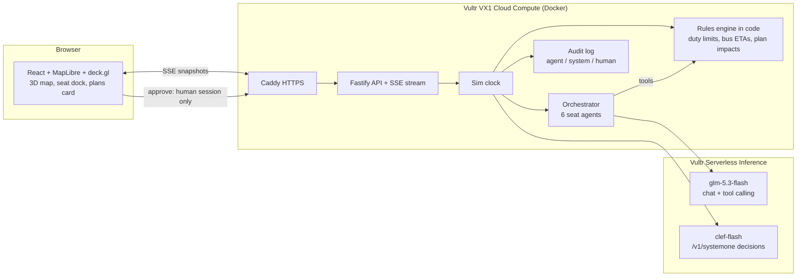

# Fly-Through

**Your pilots train in a flight simulator. Your operations room doesn't.**

Fly-Through is an airline operations-control war room where **AI agents fill every seat** (Ops Duty Manager, Crew Control, Network Control, Hub Control, Guest Recovery, Crew Hotline) and work a real disruption together, while **one human approves** the recovery plan. It replays a bad day so an ops team can see where time is lost, and rehearses a plan before it goes live.

**Live demo:** https://64.177.57.178.sslip.io (opens on a recorded run; press **Use live AI** for a fresh run with live Vultr inference)

Built for the **Vultr: Agent Rush** hackathon (Track 2: Powering the Future of Work). It is an operations-control workflow that spans the track's focus areas: guest rebooking and care is **customer support**, buses and hotels for crews are **procurement**, and crew legality and standby cover is **workforce management**.

> The demo is one shared session. If you arrive mid-run, press **Reset**; the sim also rewinds by itself 3 minutes after the last viewer leaves.


## The scenario: fog at the hub

A synthetic day inspired by a documented fog morning at a Gulf hub:

1. **05:52** Fog closes the hub (visibility 150 m). 16 inbound flights divert to Dubai World Central, Sharjah, Al Ain and Bahrain, and the guest counter climbs.
2. The six seats call out, check facts with tools, and hand work to each other ("Crew Hotline → Crew Control: C07 at DWC has 44 minutes left").
3. **06:58** Decision point. The sim pauses and three recovery plans arrive: **A** wait for the fog, **B** bus standby crews now, **C** cancel 4 flights. Their impacts (guests protected, crews kept legal, delay, cost) are computed in code. A **Vultr decision model** scores them with calibrated probabilities (B ≈ 98% in the shipped run).
4. **Only the human can approve.** After approval, buses leave the hub on the map with live ETAs, crews are relieved on arrival, and the seats brief the plan.
5. **09:30** The fog lifts and a debrief shows time-to-decision, guests protected, crews kept legal, handoffs, and how many call-outs were backed by tool checks.

## Vultr services used

| Service | What it does here |
|---|---|
| **Vultr Cloud Compute (VX1)** `vx1-g-2c-8g`, Atlanta | Runs the whole app (Node server + web client) in Docker behind Caddy (automatic HTTPS). Boots from a **bootable Block Storage** volume, one of VX1's newest options. |
| **Vultr Serverless Inference: chat** `glm-5.3-flash` | The brain of all six seat agents: OpenAI-compatible tool calling. Chosen after timing three models (glm-5.3-flash 1.0 s per tool round-trip, deepseek-v4.1-flash 1.35 s, qwen3.8-flash-next 1.85 s). |
| **Vultr Serverless Inference: decision model** `clef-flash` via `/v1/systemone` | Scores the three recovery plans with a probability per option and a confidence. It answers in about 0.3 s, and nobody has to parse free text. |

The inference key exists only on the server (`.env`, `chmod 600` on the VM). It is never sent to the browser and never baked into the image.

## Architecture



## How the agents execute real work

- **Seats are role prompts plus tools.** `get_situation`, `get_crew_status`, `get_bus_time` and `send_message` read state computed by the rules engine. Every number an agent states must come from a tool result, and each call-out shows which tools backed it (`checked: get_crew_status, get_bus_time`).
- **Cooperation is visible.** Seats run in parallel when the clock reaches their cue. `send_message` hands a task to another seat and wakes it, with a hop limit so seats can't loop. The dock shows who is thinking and who spoke; the subtitle shows the handoff.
- **Hard numbers live in code, never in a model:** duty time left (a simplified illustrative duty table), road times between airports, guests stuck, and each plan's impact and cost. The decision model reads those computed facts plus the seats' latest messages; it does not invent them.
- **Human-only approval is enforced by the server.** No agent has an approve tool, and `POST /api/approve` requires the browser's approver session cookie (it returns 403 without it). The agents are also told they never approve, dispatch or activate anything.
- **The demo can't fail.** Every live run is recorded; **recorded mode** replays a curated live run (`recordings/fog-at-hub.json`) with no model calls. If the decision model is down, the plans stay approvable on their computed impacts.
- **Audit trail:** `GET /api/audit` lists every agent call-out and handoff, every model score and every human approval, each with its actor.

## Run it locally

```bash
cp .env.example .env               # add your Vultr Serverless Inference API key
npm install
node --env-file=.env --import tsx src/server/index.ts   # API on :8080
npx vite                           # UI on :5173 (proxies /api)
npm test                           # 22 unit tests: rules, plans, orchestrator, approval, recorded mode
```

Deploy: `docker compose up -d --build` on the VM (set `SITE_ADDRESS` for your domain; it defaults to `<ip>.sslip.io`).

## Same engine, next industry

The engine is domain-neutral: seats, tools over a computed state, a decision gate and a human approver. The same pattern rehearses a **telecom network outage** (NOC, core engineer, field engineers bound by travel time) or a **planned network change** before it touches production.

## Data, credits and honesty

- **Synthetic scenario:** fictional airline (flight prefix FT), invented flights, crews and guest counts. Duty and cost rules are simplified and illustrative, not regulatory or airline data. No real airline branding.
- **Imagery:** NASA Blue Marble via GIBS (public domain). **Airport layouts:** © OpenStreetMap contributors (ODbL).
- **3D models and portraits:** generated with Meshy (paid plan, customer-owned).

## License

MIT (see [LICENSE](LICENSE)).
